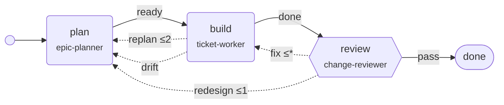

# crew

Write each agent and skill once, as harness-agnostic Markdown: one file per agent, one folder with a `SKILL.md` per skill. `crew compile` points Claude Code, Codex, OpenCode, Gemini CLI and Cursor at them.

**Every harness points back at crew.** Each skill in a harness is a link to `skills/<name>/`, so skill edits are live everywhere with no compile. Agents need different fields in each harness, so `compile` generates each harness's version under `build/<harness>/` and links the harness's agent file to it; agent edits need a compile. (`--scope project` writes real copies instead, since a repo can't commit links into your home directory.)

```
~/crew/                   ← your crew directory
├── harnesses.yaml            facts: paths, field names, tool names, which model catalog each harness uses
├── models.yaml               the baseline list: every model + effort each harness can run, with prices
│                             (generated by `crew models sync`; don't edit by hand)
├── crew.yaml                 choices: which harnesses are on, which agents each gets
├── agents/                   one file per agent
│   ├── ticket-worker.md
│   ├── change-reviewer.md
│   └── code-explorer.md
├── skills/                   one folder per skill, linked into every harness
│   └── pr-description/
│       ├── SKILL.md
│       └── scripts/ …        any supporting files come along
├── factories/                one file per factory: agents chained into a production line
│   └── ship-change.md
└── build/                    generated agent files and factory diagrams (gitignored)
```

## Install

```sh
go mod tidy
go install ./cmd/crew
```

## Use

```sh
crew init                 # scaffold ~/crew (or --dir somewhere)
cd ~/crew
crew models               # every model, effort and price for your enabled harnesses
crew models --all         # ... for every harness (or --harness opencode)
crew models sync          # refresh models.yaml from models.dev
crew capabilities         # which native tools each capability becomes, per harness
crew verify               # strict check; warnings count as failures (-v shows notes)
crew plan                 # per harness: agent → model, effort, $/MTok, plus file changes
crew compile --dry-run
crew compile              # links ~/.claude, ~/.config/opencode, ... to crew
```

Coming from `crewfile`? `crew migrate` moves `~/crewfile` to `~/crew` (and `crewfile.yaml` → `crew.yaml`, `.crewfile/` → `.crew/`) keeping crew's ownership records; then `crew compile` re-points every harness link. `--dry-run` shows the steps first.

Per repo instead of per user:

```sh
crew compile --scope project --project ~/src/payroll-service
```

To see exactly what would land before touching your real dot-dirs (handy when porting to the work laptop):

```sh
crew compile --out /tmp/crew-preview
```

## Factories

A factory chains agents into a production line. Each **station** runs one agent; the agent's result picks a **route**, which sends the work forward or back to *any* earlier station. `crew run` drives it; the `orchestrator` agent lets you talk to a run while it works.

```markdown
---
name: ship-change
description: Plans, builds and reviews one change in the current repo, sending work back when it isn't ready.
start: plan
harness: claude-code
stations:
  plan:
    agent: epic-planner
    routes:
      ready: build
  build:
    agent: ticket-worker
    on_drift: plan              # files changed outside the run since the last station: re-plan first
    routes:
      done: review
      replan: {to: plan, max: 2}
  review:
    agent: change-reviewer
    approve: true               # pause after review so you can accept or redirect
    routes:
      pass: done
      fix: {to: build, max: "*"}
      redesign: {to: plan, max: 1}
---
This factory takes one change request (the run input) to a reviewed result in the current repository.

- plan: say exactly which files change and how. If anything is ambiguous, make the call and record it in notes as an assumption.
- build: implement exactly the plan. Never ask questions; if the plan is incomplete or wrong, return `replan`.
- review: check the change against the plan. `fix` for problems the builder can fix, `redesign` when the plan itself was wrong.
```

`crew factory diagram ship-change` (and `build/factories/ship-change.md` after a compile):



Rules (all checked by `crew verify`):

- **Routes** are `name: station` or `name: {to: station, max: N}`. `done` and `fail` end the run; every station may also return `fail` without listing it.
- **Every loop needs a limit** on at least one of its routes: a number, or `"*"` (in quotes) for "until it passes". A loop with no limit is an error. Taking a route more times than its limit stops the run and reports which route.
- **`approve: true`** pauses after that station: `crew run approve <id>` follows the station's choice, `--goto S` sends it elsewhere. No approval stops = the run goes start to finish.
- **`on_drift: S`** checks the watched git trees before the station runs; if anything changed since the previous station finished (outside the run), the work goes to `S` first. `watch:` lists the roots (default: the project). Drift redirects don't count toward limits.
- Stations never ask you questions. Anything they assumed comes back as a note; if something is missing they route the work back.
- `harness:` (factory or station) is where stations run. That harness needs a `headless:` command in `harnesses.yaml`; unattended stations get exactly their agent's capabilities pre-allowed and nothing more. Bypass-permission flags are rejected.

### Running

```sh
crew run ship-change --input "Add a /health endpoint"     # foreground; Ctrl-C interrupts cleanly
crew run ship-change --input @request.md --detach         # background; logs to .crew/runs/<id>/run.log
crew run status                                          # list runs in this project
crew run status <id> --since 0                           # state + events (ends with "cursor N")
crew run status <id> --since 0 --wait 90s                # like status, but returns early on news
crew run say <id> "use port 8081"                        # delivered to the next station
crew run say <id> - < note.txt                           # the message comes from stdin
crew run goto <id> plan                                  # send the work to a station (live or stopped run)
crew run approve <id> [--goto build]                     # continue past an approval stop
crew run resume <id>                                     # continue an interrupted or retryable run
```

For `crew run`, a `-` reads stdin wherever text or `@file` is taken (`--input -`, `say <id> -`, `--note -`). Nothing on stdin, or more than 1 MB, is refused, and so is a flag the command doesn't take.

Each run lives in `<project>/.crew/runs/<id>/` (crew writes `.crew/.gitignore` so it never reaches git): `input.md`, a frozen `factory.md`, `state.json`, `events.jsonl`, and `steps/<n>-<station>/{prompt,output,verdict}`. Every station's prompt points at earlier outputs by path. Only one process drives a run at a time.

### Talking to a run

`crew compile` prints an `orchestrator:` line for each harness that can host one as the main session. Start the orchestrator with that line, then tell it which factory to run and what to produce. It starts the run, watches it, tells you what matters, passes what you say to the stations, and asks you at approval stops. In its session `crew run status`, `say` and `resume` are pre-approved. `crew run approve` and `crew run goto` ask you first even when another setting allows them: crew writes `ask` rules for them into the session's settings, and Claude Code checks `ask` rules before `allow` rules (a session started with permission checks bypassed asks about nothing). Starting a run has no `ask` rule, so it asks only when no other setting allows it and the session is in a mode that asks; answer it with a one-time yes, not "don't ask again". If you used foremen, open `/permissions` in the repo and remove rules that allow `crew run` as a whole, `crew run approve` or `crew run goto`. A `harnesses.yaml` that still says `foreman:` gets the `ask` rules only after `crew mission setup`. It never runs a station, edits files or chooses routes: the engine does all of that, so a factory behaves the same with or without the orchestrator.

An older `foreman-<factory>` agent is removed by the next `crew compile`; one in a project's dot-dirs is removed by the next compile of that project, and one you edited by hand stops the compile with a message naming it.

## Missions

A mission is a job split into pieces. Each piece runs through a factory in its own git worktree and ends as one pull request, which you merge on GitHub (or crew merges, if you switch auto-merge on for its domain); crew then starts the next piece. You plan and steer a mission through the `orchestrator` agent, or with `crew mission` commands. The same agent also starts and watches a single factory run when that is all you need.

```sh
crew mission setup                    # once, for an older crew directory: missions.yaml and domains/
crew repo confirm                     # once per repo, in a terminal
crew mission plan @plan.md            # check a plan and create the mission
crew mission start <id>               # run the start checks
crew mission go <id>                  # your go: the engine starts
crew mission status <id>              # what runs, and what waits on you
crew automerge on --domain D          # let crew merge a domain's pull requests; in a terminal
crew jira setup --site URL --key KEY  # show a repo's missions on a Jira board; checks the site, confirms in a terminal
crew jira check                       # test the repo's Jira settings against the site
crew jira sync <mission>              # send the Jira writes a mission still owes
```

A piece can also end in a deliverable (files such as a brief) instead of, or as well as, a pull request. With Jira set up, a mission shows on your board as an epic with an issue per piece, and a deliverable is attached to its piece's issue; you accept it by moving the issue to Done or with `crew mission answer --do accept`.

See [docs/missions.md](docs/missions.md) for setup, the commands, and what the safeguards do and don't cover.

## Source format

Agents:

```markdown
---
name: ticket-worker                 # must equal the filename
description: Implements one scoped ticket end to end. Use when ...
model: claude-opus-5-5              # an id from models.yaml, or "inherit" (follow the session)
effort: high                        # optional; must be one this model accepts
per_harness:                        # optional; a different pick where the model above isn't available
  opencode: {model: opencode-go/kimi-k3.1-pro, effort: high}
capabilities: [read, search, edit, write, shell]   # or [all] to inherit everything
skills: [go-backend-conventions]    # optional; preloaded where the harness supports it
---
The system prompt.
```

Skills (`skills/<name>/SKILL.md`; the folder name is the skill name; any other files in the folder are part of the skill):

```markdown
---
name: pr-description
description: Writes a PR description reviewers can approve quickly. Use when opening a PR.
---
The instructions.
```

For agents, those are the only keys allowed: anything harness-specific is rejected at verify time and belongs in `harnesses.yaml`. Skills are linked as-is, so a `SKILL.md` may carry other keys (`license`, `allowed-tools`, `metadata`, …); crew only checks `name` and `description`.

## How the agnostic parts map

**Model + effort, per agent.** Each agent names its model and effort directly, using the ids in `models.yaml`. Ids are spelled the way the harness spells them: `claude-opus-5-5` for Claude Code, `opencode-go/kimi-k3.1-pro` for OpenCode. Claude Code only runs Claude models, so an agent that also goes to OpenCode on the Go plan needs a `per_harness.opencode` pick. `verify` tells you when one is missing. Giving `per_harness` a new model drops the top-level effort (it was chosen for a different model), so set the effort there too.

How it's written: Claude Code gets `model:` and `effort:`; Codex gets `model` and `model_reasoning_effort`; OpenCode gets the effort as a model variant (`model: opencode-go/kimi-k3.1-pro#high`); Gemini CLI has no per-agent effort, so it's dropped; Cursor has no model list, so agents use `inherit`.

**The model list.** `crew models sync` downloads [models.dev](https://models.dev), the catalog OpenCode itself uses, and writes `models.yaml`: for each harness, every non-deprecated model from the providers in its `catalog:` block, with the effort levels that model accepts, its context size and its price. Effort levels differ by model (on the Go plan, Kimi K3 accepts only `max`), and `verify` checks each agent against them. Sync prints the models that were added or removed.

**Capabilities → native tools.** `read, search, edit, write, shell, web, delegate` become `Read, Grep, Glob, …` in Claude Code, a `tools:` true/false map in OpenCode, a tool list in Gemini CLI, `sandbox_mode` in Codex and `readonly` in Cursor.

A capability a harness has no tool for (OpenCode has no `structured-output`) is dropped for that harness; `plan` and `verify -v` note each one.

**Skills are global.** Every enabled harness gets every skill. When one harness already reads another's skill directory (OpenCode loads `~/.claude/skills` and `~/.agents/skills`), `shares_with` stops a duplicate copy being written.

## Strict verification

`verify` (and therefore `compile`) fails on:

- unknown keys anywhere: source frontmatter, `harnesses.yaml`, `crew.yaml`
- a name that differs from its filename, isn't kebab-case, or breaks a harness rule (for example, Claude Code names can't contain "claude")
- unknown capabilities, skills, agents, harnesses or globs that match nothing
- an agent without a model, or with a model that isn't in that harness's list in `models.yaml`
- an effort value that the agent's model doesn't accept
- a missing `models.yaml`, or one with no list for a harness that has a catalog
- a harness missing a mapping for any capability
- two harnesses writing different content to the same path
- stray files or folders in `agents/`, a file directly in `skills/`, or a skill folder without `SKILL.md`
- **warning:** `harnesses.yaml` `verified` date, or `models.yaml` `fetched` date, older than `stale_after_days`. Warnings are fatal unless you pass `--allow-warnings`. This one is deliberate: these formats change every few months.

## Safety

crew keeps a record (`.crew/state.*.json`, gitignored) of every file and link it wrote, with its hash or link target.

- It only overwrites or deletes files and links it wrote. A folder it didn't write (say, your own skill with the same name) is a `CONFLICT`.
- A folder of copies an older compile wrote is replaced by a link, but only if every file in it is unchanged.
- A hand-edited output, or a file it didn't create, shows up as a `CONFLICT`. Nothing is written until the conflict is resolved, or until you pass `--force`.
- When you delete a source, its outputs are removed on the next compile, and so are empty skill folders.
- Writes and links are atomic (temp file or temp link + rename).

## Adding a harness

Add an entry under `harnesses:` in `harnesses.yaml`. Set its skill and agent dirs, `format` (`markdown` or `toml`), the output key names in `fields`, any `static` keys, any `derived` keys (computed from capabilities), the capability → tool map, and a `catalog:` block (models.dev providers and `id_style`). Run `crew models sync`, then add it to `targets:` in `crew.yaml`. You only touch Go code for a format that isn't Markdown frontmatter or TOML.

## Facts to double-check before trusting them

Everything in `harnesses.yaml` was researched on 2026-11-18. Confirm these against your installed versions:

- Model ids and effort levels come from models.dev. Spot-check them against `/models` in OpenCode or `/model` in the other harnesses; they can lag a release by a few days.
- OpenCode takes the effort as a model variant (`#high`). Variant names come from the same catalog, but not every model has one for every effort.
- Claude Code reads `effort` in agent frontmatter, but the field is missing from the docs table.
- Codex's agent-level `sandbox_mode: read-only` reportedly doesn't block writes in recent versions. Don't treat it as a security boundary.
- Cursor has no model list in crew, because Cursor bills by plan; agents sent there must use `inherit`.
